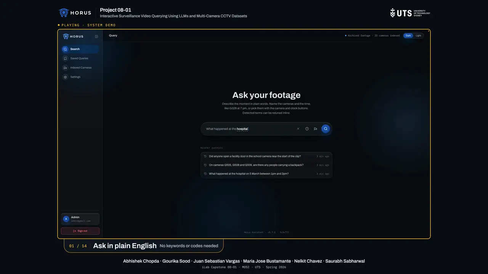
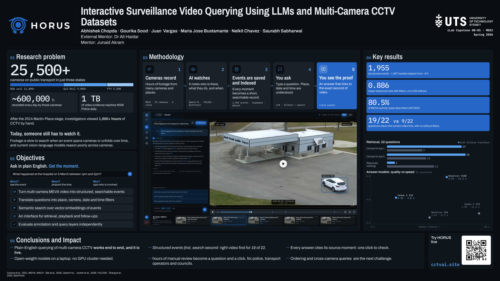

# Horus — Surveillance Video Query API (Backend)


-3FCF8E?style=flat&logo=supabase&logoColor=white)


The FastAPI service behind **Horus**, a system for asking questions about multi-camera CCTV footage in plain English, for example _"What happened at the hospital on 5 March between 1pm and 2pm?"_. This backend verifies the user's Supabase session. It then runs the retrieval-augmented (RAG) layer in-process: rule-based place, camera, date and time filters, semantic search over Qdrant, and an answer from an LLM. Each retrieved event is enriched from the annotation pipeline's Postgres tables, and the results stream back to the frontend as cited, playable moments. It also serves the conversational assistant, clip and camera detail, per-object bounding-box tracks, thumbnails, and saved and recent queries.

**Live API:** [surveillance-api.nelkit.dev/docs](https://surveillance-api.nelkit.dev/docs) · **Live app:** [cctvai.site](https://cctvai.site)

---

## 🎬 Demo

### Video walkthrough

[](https://media.nelkit.dev/projects/demos/horus-demo-loop-4k-dark.mp4)

_48-second highlight: ask in plain English, review the detected filters, read a cited answer and jump to the exact second. Every step in the clip is served by this API._

[](https://media.nelkit.dev/projects/demos/horus-demo-loop-4k-dark.mp4)

### Showcase poster

[](docs/media/poster/poster-dark.png)

_Click the image to open the full-resolution poster (8164 × 4592)._

---

## Table of Contents

- [Overview](#-overview)
- [System Architecture](#️-system-architecture)
- [Local Setup](#-local-setup)
- [Environment Variables](#-environment-variables)
- [API](#-api)
- [Testing](#-testing)
- [Data Sources](#️-data-sources)
- [Retrieval Pipeline](#-retrieval-pipeline)
- [Deployment](#️-deployment)
- [Known Limitations](#️-known-limitations)
- [Team](#-team)
- [Links](#-links)

---

## 🧭 Overview

- **Subject:** 36105 iLab: Capstone Project, Spring 2026 (UTS)
- **Project:** 08-01 Interactive Surveillance Video Querying Using LLMs and Multi-Camera CCTV Datasets
- **Scope:** 71 development clips from the [MEVA](https://mevadata.org/) dataset (about 5.9 hours from 23 cameras at four sites), turned into 1,955 structured events by the annotation pipeline
- **Live API:** [surveillance-api.nelkit.dev](https://surveillance-api.nelkit.dev/docs) (OpenAPI docs at `/docs`)
- **Live app:** [cctvai.site](https://cctvai.site)

A user signs in on the frontend with Supabase Auth. Every request reaches this API with the session token as `Authorization: Bearer <token>`, and the backend checks it against Supabase's public JWKS. On a search, the backend calls the RAG package in-process. The package extracts place, camera, date and time filters by rule, narrows the Qdrant index with them, ranks the remaining events by meaning and writes a cited answer. The backend then looks up each returned `event_id` in the annotation pipeline's `bronze` tables to add the camera, scene, tags, clip timing, thumbnail and video URL. Progress streams to the browser over Server-Sent Events. When the user opens a moment, the backend serves the clip, its tracked bounding boxes and nearby clips, and the assistant answers follow-up questions using only the moments on screen.

This repo **does not** run the vision-language model, build the vector index, or store video files. Those belong to the sibling repositories below.

### Related repositories

All repositories live in the [uts-ilab-p08](https://github.com/uts-ilab-p08) organisation.

| Repository | Role |
|---|---|
| [videometa](https://github.com/uts-ilab-p08/videometa) | Annotation library: VLM window-significance filter (Qwen3-VL), YOLO26 + ByteTrack tracking, and VLM annotator that writes plain-English events with element coordinates |
| [video-annotation-pipeline](https://github.com/uts-ilab-p08/video-annotation-pipeline) | Runs videometa over the MEVA clips and loads events, objects and geometries into the Supabase `bronze` schema; videos are served from Cloudflare R2 |
| [iLabs-capstone-rag](https://github.com/uts-ilab-p08/iLabs-capstone-rag) | RAG layer, packaged as `ilabs-cctv-rag`: bge-base embeddings, Qdrant index, rule-based filters and cited answers. Installed here as a dependency |
| **[surveillance-backend](https://github.com/uts-ilab-p08/surveillance-backend) (this repo)** | FastAPI service: session check, search and assistant endpoints, SSE progress, clip and track reads, saved and recent queries |
| [cctv-query-frontend](https://github.com/uts-ilab-p08/cctv-query-frontend) | Next.js web app on Vercel: search, results workspace, video player with tracked boxes, assistant chat |

---

## 🏗️ System Architecture

```text
┌──────────────────────┐   Bearer JWT    ┌──────────────────────────────────────────────┐
│  cctv-query-frontend │ ──────────────► │  surveillance-backend  (FastAPI, /api/v1)     │
│  Next.js · Vercel    │ ◄────────────── │                                              │
└──────────┬───────────┘   JSON / SSE    │  app/api/deps.py   verify JWT via JWKS (ES256)│
           │                             │  routes/search     ─┐                         │
           │ sign-in                     │  routes/assistant  ─┼─► ilabs-cctv-rag        │
           ▼                             │  routes/vocabulary ─┘   (in-process package)  │
┌──────────────────────┐   JWKS          │  routes/clips, videos, cameras ─► bronze.*   │
│  Supabase Auth       │ ◄────────────── │  routes/queries ─► app.saved_queries,        │
│  (GoTrue, ES256)     │                 │                    app.recent_queries        │
└──────────────────────┘                 └──────┬─────────────────┬──────────────┬──────┘
                                                │                 │              │
                                  embed + filter│      LLM answer │   SQL reads  │ frame
                                                ▼                 ▼              ▼ extraction
                                   ┌────────────────┐ ┌──────────────┐ ┌───────────────────┐
                                   │ Qdrant (hosted)│ │ OpenRouter   │ │ Supabase Postgres │
                                   │ meva_events,   │ │ (OpenAI chat │ │ bronze.* (events, │
                                   │ 768-d bge-base │ │ completions) │ │ objects, videos,  │
                                   └────────────────┘ └──────────────┘ │ geometries)       │
                                                                       │ app.* (queries)   │
                                                                       └───────────────────┘
                                                          Cloudflare R2: MP4 clips (PyAV
                                                          reads them for thumbnails)
```

| Layer | Path | Responsibility |
|---|---|---|
| Entry point | `app/main.py` | App, CORS and router wiring. `/health` is unprefixed; everything else is under `/api/v1` |
| Auth | `app/api/deps.py` | Verifies Supabase JWTs against `SUPABASE_URL/auth/v1/.well-known/jwks.json`; local HS256 fallback when `SUPABASE_URL` is unset |
| Routes | `app/api/routes/` | `search`, `assistant`, `clips`, `videos`, `cameras`, `queries`, `vocabulary`, `health` |
| RAG client | `app/services/rag_client.py` | Calls `rag.pipeline.answer_query()`, keeps each source's `citation_index`, enriches from `bronze` |
| Assistant | `app/services/assistant.py` | Prompt building over the given moments, citation checking, rule-based suggestions |
| Reads | `app/services/bronze.py`, `tracks.py`, `clip_builder.py`, `tagging.py` | Read-only queries over `bronze`; builds the frontend's `Clip` shape and closed tag set |
| Thumbnails | `app/services/thumbnails.py` | Extracts one JPEG per clip from the R2 MP4 with PyAV and caches it on disk |
| Streaming | `app/services/sse.py` | Server-Sent Events formatting for `/search/stream` and `/assistant/ask/stream` |
| Data | `app/db/`, `alembic/` | SQLAlchemy models and migrations for this service's own `app` schema |

---

## 🚀 Local Setup

### Before you start

| Requirement | Why |
|---|---|
| Python 3.11+ (`.python-version` pins 3.13.7) | Runs the API and the in-process RAG package |
| Docker | Local Postgres 16 for the `app` schema (`docker-compose.yml`) |
| Git access to `uts-ilab-p08/iLabs-capstone-rag` | `pip` installs `ilabs-cctv-rag` straight from its GitHub tag |
| Qdrant URL + API key, and an OpenRouter API key | Needed for `/search`, `/vocabulary` and `/assistant/ask`. Without them, the other routes still work |
| ~1 GB free RAM | The bge-base embedding model loads in-process on the first search (~800 MB peak) |

### Clone the repository

```bash
# SSH
git clone git@github.com:uts-ilab-p08/surveillance-backend.git
# or HTTPS
git clone https://github.com/uts-ilab-p08/surveillance-backend.git

cd surveillance-backend
```

### Step 1 — Create a virtual environment and install dependencies *(required)*

```bash
python -m venv .venv
source .venv/bin/activate          # Windows: .venv\Scripts\Activate.ps1
pip install -r requirements.txt
```

This also installs `ilabs-cctv-rag` (the `rag` module) from the pinned tag in `requirements.txt`.

### Step 2 — Configure the environment *(required)*

```bash
cp .env.example .env               # Windows (PowerShell): Copy-Item .env.example .env
```

Fill in the values described in [Environment Variables](#-environment-variables). For a fully local setup, you can leave `SUPABASE_URL` empty (see Step 5).

### Step 3 — Start Postgres and apply migrations *(required)*

```bash
docker compose up -d               # Postgres 16 on localhost:5432; seeds a stub auth.users table
alembic upgrade head               # creates the app schema (saved_queries, recent_queries)
```

The stub in `db-init/001_stub_supabase_auth.sql` only runs on a fresh volume. If your container already existed, reseed it with `docker compose down -v && docker compose up -d`.

### Step 4 — Run the API

```bash
uvicorn app.main:app --reload
curl http://localhost:8000/health  # {"status":"ok"}
```

Swagger UI is at [http://localhost:8000/docs](http://localhost:8000/docs).

### Step 5 — Get a token

- **With the team's Supabase project:** set `SUPABASE_URL`, sign in through the frontend, and copy the session's access token.
- **Without Supabase access:** leave `SUPABASE_URL` empty and mint a local token for the seeded test user (`00000000-0000-0000-0000-000000000001`):

  ```bash
  python scripts/make_test_jwt.py    # prints a token and a ready-to-run curl command
  python scripts/make_test_jwt.py --user-id <uuid> --email someone@example.com
  ```

  This token is signed with `LOCAL_DEV_JWT_SECRET` and is accepted only while `SUPABASE_URL` is unset.

```bash
TOKEN="<your token>"
curl -s -H "Authorization: Bearer $TOKEN" \
  "http://localhost:8000/api/v1/search?q=did+anyone+enter+the+building"
```

---

## 🔐 Environment Variables

```bash
cp .env.example .env               # bash
Copy-Item .env.example .env        # PowerShell
```

Two groups of variables share one `.env`. `app/core/config.py` reads this service's own settings. The `ilabs-cctv-rag` package reads its own settings directly from the environment (`rag/config.py`).

### Required

| Variable | Read by | Description |
|---|---|---|
| `SUPABASE_URL` | Backend | Supabase project URL (`https://<ref>.supabase.co`). JWTs are verified against its public JWKS. Not a secret. Leave empty only for local development |
| `DB_USER`, `DB_PASSWORD`, `DB_HOST`, `DB_PORT`, `DB_NAME` | Backend | Postgres connection for the `app` and `bronze` schemas. Locally, the defaults match `docker-compose.yml`; in production they point at the Supabase pooler. Kept as separate fields so passwords with `@` are encoded safely |
| `QDRANT_URL` | RAG package | Hosted Qdrant cluster URL. **Must be set in production**: if empty, the package silently falls back to an empty embedded local index |
| `QDRANT_API_KEY` | RAG package | API key for the Qdrant cluster |
| `LLM_API_KEY` | RAG package | OpenRouter (or any OpenAI-compatible) API key |
| `LLM_MODEL` | RAG package | Answer model, for example `nvidia/nemotron-3-ultra-550b-a55b:free`. No default |

### Optional (with defaults)

| Variable | Default | Description |
|---|---|---|
| `ENVIRONMENT` | `development` | `development`, `test` or `production` |
| `API_V1_PREFIX` | `/api/v1` | Prefix for every route except `/health` |
| `CORS_ORIGINS` | `http://localhost:3000` | Comma-separated allowed origins (set the frontend's URL in production) |
| `PUBLIC_BASE_URL` | the request's own URL | Absolute `https://` base used to build `thumbnail_url`. **Set it in production**: behind a proxy, the fallback can be `http://`, and an https frontend then blocks every thumbnail as mixed content |
| `THUMBNAIL_CACHE_DIR` | OS temp dir | Where extracted JPEG thumbnails are cached |
| `LOCAL_DEV_JWT_SECRET` | `change-me-for-local-dev-only` | HS256 secret for `scripts/make_test_jwt.py`. Ignored once `SUPABASE_URL` is set |
| `LLM_BASE_URL` | `https://openrouter.ai/api/v1` | OpenAI-compatible chat-completions endpoint |
| `QDRANT_COLLECTION` | `meva_events` | Qdrant collection name |
| `EMBED_MODEL` | `BAAI/bge-base-en-v1.5` | Embedding model (fastembed, ONNX) |
| `EMBED_DIM` | `768` | Embedding dimension |
| `TOP_K` | `5` | Maximum sources the RAG package returns per question |
| `FASTEMBED_CACHE_PATH` | fastembed default | Where the embedding model is downloaded. Point it at persistent disk to avoid re-downloading after restarts |
| `HF_TOKEN` | — | Optional Hugging Face token. Silences the unauthenticated-download warning and speeds up the model download |

### Not needed at runtime

| Variable | Default | Description |
|---|---|---|
| `DATABASE_URL` | — | Used by the RAG package only to **build** the index from `bronze`. Answering questions needs only Qdrant and the LLM |
| `DB_SCHEMA` | `bronze` | Schema the RAG indexer reads from |

---

## 💻 API

Every route except `/health` and `/clips/{id}/thumbnail.jpg` requires `Authorization: Bearer <Supabase JWT>`. All routes live under `/api/v1` except `/health`. The full schema is at [`/docs`](https://surveillance-api.nelkit.dev/docs).

| Method | Path | Description |
|---|---|---|
| `GET` | `/search` | Natural-language search. Calls the RAG package, then enriches each source from `bronze` (event name, description, camera, scene, tags, timing, `thumbnail_url`, `capture_start_local`, `citation_index`). Records the query in recent queries and bumps `hits` on a matching saved query |
| `GET` | `/search/stream` | Same parameters and payload as `/search`, as Server-Sent Events: `status` events, then one `result` (or `error`). A plain GET, so the frontend can use `EventSource` |
| `GET` | `/vocabulary` | Scenes, location synonyms, cameras and capture dates that the search field can name, read live from the Qdrant index. 502 if Qdrant is unreachable |
| `POST` | `/assistant/ask` | Follow-up chat grounded only in the `moments` sent in the request. Stateless: the frontend resends `query`, `moments`, `history`, `scope` and `focus_moment_id`. Citations the model returns are checked against the request |
| `POST` | `/assistant/ask/stream` | Same contract as `/assistant/ask`, as SSE status events plus the result. Needs `fetch()` with a manual stream reader (the request has a body) |
| `POST` | `/assistant/suggestions` | Opening suggested questions. Rule-based, not an LLM call, so it never suggests a question the data cannot answer |
| `GET` | `/clips/{id}` | One clip by `event_id`, from `bronze` |
| `GET` | `/clips/{id}/related` | Nearby clips on the same camera, closest in time first |
| `GET` | `/clips/{id}/thumbnail.jpg` | **Public.** One JPEG frame (the moment with the most detected objects), extracted with PyAV on first request and cached |
| `GET` | `/videos/{video_id}/tracks` | Per-object bounding-box tracks from `bronze.geometries`. `start_seconds` and `end_seconds` are validated against the video's duration (422 if out of range) |
| `GET` | `/cameras` | Camera directory: camera code, scene and event count |
| `GET` | `/queries/recent?limit=N` | The user's recent searches, newest first. `limit` 1–100, default 20 |
| `GET` | `/queries/saved` | The user's saved queries |
| `POST` | `/queries/saved` | Saves a query. Idempotent: saving the same normalised text again returns the existing row |
| `DELETE` | `/queries/saved/{id}` | Deletes a saved query. Returns 404 (not 403) for another user's id, so ids cannot be probed |
| `GET` | `/health` | Liveness check, no auth, unprefixed |

### Response conventions

- **`score` / `confidence`** is the RAG layer's raw relevance score (0–1 float), passed through unscaled. The frontend converts it to a percentage.
- **`citation_index`** is the 1-based position of the source in the RAG answer, assigned before any result is filtered out. `[n]` markers in the answer text keep pointing at the right moment.
- **`capture_start_local`** (`captureStartLocal` on `Clip`) is the wall-clock start of the video file as ISO 8601 **without** an offset, for example `"2018-03-05T13:15:00"`. Show the playing frame's time as `capture_start_local + video.currentTime`, labelled as the camera's local time. Never parse it as UTC.
- **`timestamp`** is `null` whenever the video's time zone is unknown. See [Known Limitations](#️-known-limitations).

---

## 🧪 Testing

```bash
pytest tests/ -q
```

The suite runs against FastAPI's `TestClient` with the auth dependency, the database session and the RAG package overridden, so it needs no Supabase, Qdrant or LLM credentials. It covers every route plus the RAG client, assistant, clip builder, thumbnails and tracks services.

| File | Covers |
|---|---|
| `tests/test_search.py`, `tests/test_rag_client.py` | `/search`, `/search/stream`, enrichment, `citation_index`, post-retrieval filters, side effects |
| `tests/test_assistant.py` | `/assistant/ask`, `/assistant/ask/stream`, `/assistant/suggestions`, citation checking |
| `tests/test_queries.py` | Recent and saved queries, idempotent save, ownership checks |
| `tests/test_videos.py`, `tests/test_tracks.py` | `/videos/{video_id}/tracks` and range validation |
| `tests/test_thumbnails.py`, `tests/test_clip_builder.py` | Thumbnail extraction and caching, `Clip` shape |
| `tests/test_vocabulary.py`, `tests/test_auth.py`, `tests/test_health.py` | Vocabulary, JWT verification, liveness |

---

## 🗃️ Data Sources

This service owns only the `app` schema. Everything else is read-only and produced by the sibling repositories.

| Source | Type | Owner | Used for |
|---|---|---|---|
| `bronze.events`, `bronze.videos`, `bronze.objects`, `bronze.event_objects`, `bronze.geometries` (+ SQL helper functions) | Supabase Postgres (read-only) | [video-annotation-pipeline](https://github.com/uts-ilab-p08/video-annotation-pipeline) | Event enrichment, clips, cameras, tracks, thumbnail frame choice |
| Qdrant collection `meva_events` | Hosted vector index | [iLabs-capstone-rag](https://github.com/uts-ilab-p08/iLabs-capstone-rag) | Semantic search and `/vocabulary` |
| MEVA MP4 clips | Cloudflare R2 (public URLs) | Annotation team | Video playback (frontend) and thumbnail extraction (PyAV) |
| `app.saved_queries`, `app.recent_queries` | Supabase Postgres (read/write) | **This repo** (Alembic) | Per-user query history. `user_id` is a foreign key to Supabase's `auth.users(id)` |

The underlying footage is the audited subset of the [MEVA dataset](https://mevadata.org/) (Corona et al., 2021): 71 development clips, 23 cameras, four sites (school, bus, hospital, admin), recorded on 5 and 7 March 2018.

---

## 🤖 Retrieval Pipeline

Search and answer generation run inside this process through the `ilabs-cctv-rag` package (pinned to `v0.1.6` in `requirements.txt`). The package's design is documented in [iLabs-capstone-rag](https://github.com/uts-ilab-p08/iLabs-capstone-rag); this is the part the backend depends on.

```text
question
  └─► rule-based filters (site, camera, date, time of day; no model call)
        vocabulary read from the Qdrant index; ambiguous or negated → no filter
  └─► Qdrant search, filters applied before ranking
        BAAI/bge-base-en-v1.5 · 768 dimensions · fastembed (ONNX, CPU)
        similarity floor 0.6, lifted once a filter matches
        up to TOP_K = 5 sources
  └─► LLM answer via OpenRouter, every claim cites an event [n]
  └─► backend: look up each event_id in bronze, attach citation_index,
        thumbnail_url and capture_start_local, apply post-retrieval filters
```

- **Answer model:** configured by `LLM_MODEL`. The team's comparison of four models picked `nvidia/nemotron-3-ultra-550b-a55b` (quality 4.91/5, median latency 11.5 s).
- **Retrieval quality** on 22 answerable test questions: correct video ranked first for 19/22 with filters vs 9/22 without (MRR 0.886 vs 0.432).
- **Assistant:** `/assistant/ask` reuses the package's `rag.llm.complete()` with its own prompt and answers only from the moments sent in the request. `/assistant/suggestions` is rule-based and prefers `bronze` annotations (object types, average confidence) over caption text.
- **Fallback:** if the LLM is unreachable, the package returns a plain summary of the top result instead of failing.

---

## ☁️ Deployment

Production runs on an **Oracle Cloud** server at [surveillance-api.nelkit.dev](https://surveillance-api.nelkit.dev/docs).

| Piece | Detail |
|---|---|
| Trigger | Every push to `main`, or a manual run (`workflow_dispatch`), of `.github/workflows/deploy-oracle.yml` |
| Action | `appleboy/ssh-action` connects to the server and runs `/opt/portfolio/deploy.sh surveillance`. The script lives on the server, not in this repo. Runs are serialised by a `concurrency` group |
| GitHub secrets | `ORACLE_HOST`, `ORACLE_USER`, `ORACLE_SSH_KEY` |
| Server environment | The variables in [Environment Variables](#-environment-variables), with `ENVIRONMENT=production`, `CORS_ORIGINS` set to the frontend URL and `PUBLIC_BASE_URL=https://surveillance-api.nelkit.dev` |
| Health check | `GET /health` → `{"status":"ok"}` |

Whatever the host, the service needs about **1 GB of RAM** (the embedding model peaks at ~800 MB on the first search), migrations applied with `alembic upgrade head`, and uvicorn bound to `0.0.0.0`:

```bash
alembic upgrade head
uvicorn app.main:app --host 0.0.0.0 --port $PORT
```

> **Earlier deploy targets.** `render.yaml` (Render, used for the final report and showcase) and `railway.json` (Railway, trialled afterwards) are kept for reference. Render's free 512 MB instance is too small for the embedding model, and the Render URL cited in the report is no longer live.

On a host with ephemeral disk, the thumbnail cache and the fastembed model are wiped on every restart. The first search then re-downloads the model (~10 s), and each thumbnail is slow again on first load (~1–6 s). Point `THUMBNAIL_CACHE_DIR` and `FASTEMBED_CACHE_PATH` at persistent storage to avoid this.

---

## ⚠️ Known Limitations

- **Request filters only narrow the top 5.** `answer_query()` has no structured-filter parameter, so `/search`'s `cameras`, `scenes`, `tags`, `min_confidence`, `date_from` and `date_to` are applied after retrieval. They can remove results but never surface one the RAG layer did not return. Filters written in the question itself (place, camera, date, time) are applied before retrieval by the RAG package.
- **`timestamp` is usually `null`.** `bronze.videos.capture_time_zone` is `'unknown'` for the indexed videos, so the backend will not invent a UTC time. `date_from`/`date_to` exclude results without a real timestamp rather than guess. Use `capture_start_local` for display. The fix belongs in the annotation pipeline.
- **`thumbnailUrl` is `null` on `/clips/{id}` and `/clips/{id}/related`.** Only `/search` fills `thumbnail_url` today, even though the same thumbnail route works for any clip.
- **One camera at a time.** Events are not linked across cameras, so the same incident can appear once per camera and counts can be inflated. Ordering questions ("after the van arrived") are not supported.
- **No rate limiting or request logging.** Neither middleware is built yet.
- **Prototype security only.** There is no audit log, retention policy or face/plate blurring, and event descriptions are sent to hosted services (Supabase, Qdrant, OpenRouter). See Section 9.2.2 of the final report before using real footage.

---

## 👥 Team

| Member | Primary contributions |
|---|---|
| Gourika Sood | **Backend lead.** Postgres event store and FastAPI layer: search and assistant endpoints integrated in-process with RAG, duplicate-safe saved queries, video tracks, SSE progress, test suite, endpoint documentation |
| Nelkit Chavez | Frontend lead, integration and deployment. Wrote the backend API contract and pending-endpoints spec, connected the frontend to these endpoints, backend support and project coordination |
| Abhishek Chopda | RAG lead. Built and packaged `ilabs-cctv-rag` (embeddings, Qdrant index, rule-based filters, cited answers) for this backend to install; retrieval and model evaluation |
| Juan Sebastian Vargas | Video annotation lead. videometa library and annotation pipeline that produce the `bronze` events this API reads |
| Maria Jose Bustamante | Evaluation lead. MEVA reference data, event matching, data audits, manual assessment and retrieval question drafts |
| Saurabh Sabharwal | Evaluation (annotation QA). LLM-judge QA pipeline, rubric, temporal IoU, human-in-the-loop review |

**Client:** Dr Ali Haidar · **Mentor:** Junaid Akram

---

## 🔗 Links

- Live app: [cctvai.site](https://cctvai.site)
- Live API docs: [surveillance-api.nelkit.dev/docs](https://surveillance-api.nelkit.dev/docs)
- Demo walkthrough (4K): [media.nelkit.dev](https://media.nelkit.dev/projects/demos/horus-demo-loop-4k-dark.mp4)
- Showcase poster: [`docs/media/poster/poster-dark.png`](docs/media/poster/poster-dark.png)
- Organisation: [github.com/uts-ilab-p08](https://github.com/uts-ilab-p08)
- MEVA dataset: [mevadata.org](https://mevadata.org/)

---

<p align="center"><sub>36105 iLab: Capstone Project | Master of Data Science and Innovation | University of Technology Sydney · Spring 2026</sub></p>
